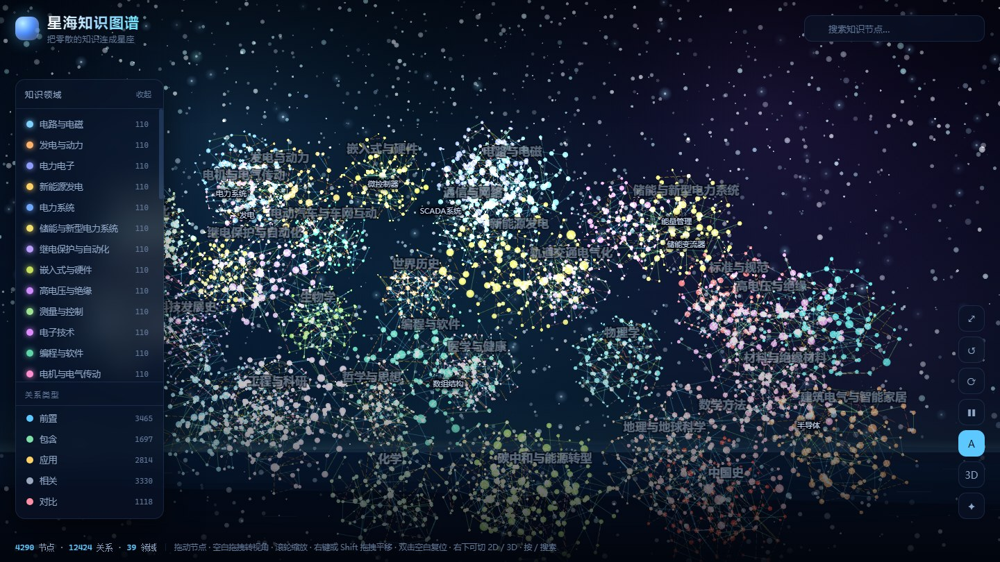

# 星海知识图谱 · Star Sea Knowledge Graph

**19815 个知识节点、34197 条关系、83 个领域**的三维交互式知识图谱。纯静态、无构建、无外部请求，推到 GitHub Pages 就能用。



## 它是什么

把电气工程相关的知识拆成一个个概念（节点），再把概念之间的关系连起来，铺成一片三维的「星海」：

- 每个**领域**是一簇星座，83 簇沿空间铺开
- 每个**节点**是一颗星，连接越多越亮越大
- 每条**关系**是一道连线，分五种类型：前置、包含、应用、相关、对比
- 点开任意节点，右侧给出定义、关键词、按关系类型分组的邻居，以及一段展开讲解

## 数据规模

| 项目 | 数量 |
| --- | --- |
| 知识领域 | 83 |
| 知识节点 | 19815（每领域 110~300，宁少不硬凑） |
| 关系总数 | 34197 |
| ├ 领域内关系 | 26148 |
| └ 跨领域关系 | 8049（27 组 cross 文件） |
| 节点详解文本 | 19815 条（每条 150~350 字） |
| 孤立节点 | 0 |
| 连通分量 | 1（19815 个节点互相可达，无孤岛） |
| 平均度 | 3.45 |

83 个领域分五组：

**电气与电子工程（20）**：电路与电磁、发电与动力、电力电子、新能源发电、电力系统、储能与新型电力系统、继电保护与自动化、嵌入式与硬件、高电压与绝缘、测量与控制、电子技术、编程与软件、电机与电气传动、数据与信号、人工智能、通信与网络、数学方法、工业自动化、标准与规范、工程与科研

**现代工程与技术（26）**：电动汽车与车网互动、建筑电气与智能家居、数据中心与算力能耗、轨道交通电气化、碳中和与能源转型、电力市场与交易、材料与绝缘材料、无线电能与近场通信、机械工程、土木与建筑工程、化学工程与工艺、航空航天工程、海洋科学与工程、农业科学与工程、食品科学与工程、环境科学与工程、石油与天然气工程、核工程与核安全、生物医学工程、航天器与空间技术、机器人学、量子信息与计算、光学与光子学、计算机图形学、区块链与分布式系统、游戏设计

**信息与数据科学（4）**：网络安全与信息安全、数据库与数据工程、软件工程、统计学

**自然科学与宇宙（15）**：物理学、化学、生物学、天文学、宇宙学与天体物理、恒星与星系、行星科学与深空探测、地理与地球科学、地质学、大气科学、生态学、医学与健康、神经科学、药学、中医学

**人文与社会科学（18）**：世界历史、中国史、世界科技发展史、经济学、哲学与思想、心理学、法学、社会学、管理学、教育学、语言学、文学、艺术、金融学、考古学、人类学、新闻传播学、音乐

## 交互

| 操作 | 效果 |
| --- | --- |
| 空白处拖拽 | 旋转视角（三维环绕） |
| 滚轮 / 双指捏合 | 拉近拉远 |
| 右键或 Shift + 拖拽 | 平移 |
| 拖动节点 | 移动节点，松手后钉住；双击节点可钉住 / 松开 |
| 点击节点 | 打开详情面板，高亮它的全部邻居，其余变暗 |
| 双击空白 | 复位视角 |
| `/` | 聚焦搜索框（支持名称、关键词、定义全文检索） |
| `F` `R` `空格` `S` | 适配全览 / 重置视角 / 暂停布局 / 自动旋转 |
| 左侧面板 | 按领域过滤、按关系类型过滤 |

右下角按钮依次是：适配全览、重置视角、自动旋转、暂停布局、标签开关、二维/三维切换、重新随机播撒。

### 两种视图

- **三维星海**（默认）：可以环绕旋转，83 个星座在空间里有前后层次
- **二维星图**：压平成一个平面，标签更易读，适合扫读和检索

点右下角的 `3D` / `2D` 按钮切换。也可以直接加参数：`index.html?r=2d` 强制走二维（无 WebGL 的环境会自动切到二维）。

## 目录结构

```
.
├── index.html                    # 页面骨架 + 全部数据分片的 script 标签
├── assets/
│   ├── css/style.css             # 全部样式
│   ├── vendor/three.min.js       # three.js r128（本地内置，不走 CDN）
│   ├── js/
│   │   ├── data.js               # 数据注册表：领域清单 + 合并/校验逻辑
│   │   ├── graph.js              # 主逻辑：三维力导向布局 + 交互 + UI
│   │   ├── render3d.js           # three.js 渲染器（GPU 点精灵 + 线段）
│   │   ├── render2d.js           # Canvas 2D 降级渲染器（无 WebGL 时用）
│   │   └── starfield.js          # 背景：星空 / 星云 / 海面波纹 / 流星
│   └── data/
│       ├── domains/<领域>.js     # ★ 83 个领域的节点与领域内关系
│       ├── edges/cross-*.js      # ★ 27 组跨领域关系（A~M、O~V、W~AB）
│       └── text/<领域>.js        # 详解文本，点开节点时才按需加载
├── tools/                        # 数据生成与维护脚本，站点运行不依赖
│   ├── validate.js               # 领域数据校验（节点数/悬空 id/孤立节点/重复边）
│   ├── validate-cross.js         # 跨领域关系校验
│   ├── validate-text.js          # 详解文本校验
│   ├── validate-one.js           # 单领域校验（比总校验严：查类型配比 + 编造嫌疑扫描）
│   ├── validate-text-one.js      # 单领域文本校验
│   ├── check-samename-edges.js   # 查「同名节点之间被标成前置/应用/包含」这类铁错
│   ├── check-coverage.js         # 查「注册了领域但文件没跟上」
│   ├── check-connectivity.js     # 全图连通分量检查（孤立簇查不出来，必须跑这个）
│   ├── check-global-dup.js       # 全库跨文件重复边检查
│   ├── normalize-text-files.js   # 详解文本规范化（清除追加式覆盖的死亡重复块）
│   ├── scan-content-quality.js   # 质量扫描：条目内重复片段 / 通用模板首句
│   ├── scan-shared-template.js   # 质量扫描：跨条目共享模板句（≥5 个条目逐字重复）
│   ├── scan-repeat-sentence.js   # 质量扫描：条目内句级复读（宽松版，输出明细）
│   ├── scan-text-bloat.js        # 体积扫描：文本文件 vs 生效内容（找死亡块）
│   ├── probe-part-direction.js   # 抽查各领域 part 边的书写方向
│   ├── dump-nodes.js             # 导出节点清单（喂给生成用的 agent）
│   └── _nodes/                   # 上面那个脚本的产物
│
│   # 下面五个是会改写数据文件的「外科手术」脚本，都必须带 --fix 才写入。
│   # dedup-edges 内置「裁剪时不产生孤立节点」的保护。
│   ├── dedup-edges.js               # 清理同一对节点被连多条边、裁掉最弱的凑数边
│   ├── normalize-part-direction.js  # 把 part 边统一成「整体 → 部件」
│   ├── fix-part-round2.js           # 同上，补翻其余领域里写反的 part 边
│   ├── edge-surgery.js              # 按清单 删除 / 反向 / 改类型 指定的边
│   └── connect-islands.js           # 给孤岛补边，让整图单连通
├── preview.jpg
├── .nojekyll
└── .github/workflows/pages.yml   # 可选的自动部署
```

## 本地预览

双击 `index.html` 即可（所有数据都是 `<script>` 标签加载，`file://` 下正常工作）。想用服务器：

```bash
python -m http.server 8000
```

## 修改数据

数据分三层，都是普通 JS 文件，改完刷新即可，**不需要任何构建**。

**节点与领域内关系** —— `assets/data/domains/<领域>.js`：

```js
KG.nodes.push(
  { id: "grid-load-flow", n: "潮流计算", c: "grid",
    d: "在给定网络结构与发电和负荷条件下求解各节点电压和支路功率的稳态计算。",
    k: ["潮流计算", "节点电压", "稳态分析"] }
);

KG.edges.push(
  ["grid-per-unit", "grid-load-flow", "prereq", 3]
);
```

- `nodes`：`id` 全局唯一（建议以领域 id 开头）、`n` 中文名、`c` 领域 id、`d` 一句话定义、`k` 关键词数组
- `edges`：`[来源 id, 目标 id, 类型, 强度]`
- 类型只能是 `prereq`（前置）/ `part`（包含）/ `apply`（应用）/ `related`（相关）/ `contrast`（对比），强度 1~3
- `prereq` 的方向是「基础 → 进阶」，`apply` 是「来源用在目标上」
- **`part` 的方向是「整体 → 部件」**（来源包含目标）：写 `["grid-power-system","grid-transmission","part",3]` 表示「电力系统包含输电」

**跨领域关系** —— `assets/data/edges/cross-*.js`，格式完全一样。
跨领域连线只负责显示，不参与力布局（否则会把星座拉成一团）。

**详解文本** —— `assets/data/text/<领域>.js`：

```js
window.KG_TEXT["grid"] = {
  "grid-load-flow": "第一段……\n第二段……"
};
```

### 加一个新领域

1. 在 `assets/js/data.js` 的 `KG_DOMAINS` 里加一行（含 id、名称、颜色、简介）
2. 新建 `assets/data/domains/<id>.js`，按上面格式写节点和边
3. 在 `index.html` 里加一行 `<script src="assets/data/domains/<id>.js"></script>`
4. 想要详解就再建 `assets/data/text/<id>.js`（没有也能跑，面板会自动留空）

## 部署到 GitHub Pages

### 方式一：分支部署（最简单）

```bash
git init
git add .
git commit -m "feat: 星海知识图谱"
git branch -M main
git remote add origin https://github.com/<你的用户名>/<仓库名>.git
git push -u origin main
```

然后 **Settings → Pages → Source** 选 `Deploy from a branch`，Branch 选 `main` + `/ (root)`。等一两分钟访问 `https://<用户名>.github.io/<仓库名>/`。

### 方式二：GitHub Actions

仓库里已带 `.github/workflows/pages.yml`。推上去后把 **Settings → Pages → Source** 选 `GitHub Actions` 即可，之后每次 push 自动发布。

### 关于体积

站点本体约 **21 MB**（数据 16.6 MB + three.js 0.6 MB）。单文件最大约 170 KB（详解文本按领域分片），远低于 GitHub 的限制。
详解文本是按领域分片的，首次点开某领域的节点时才会加载该领域那一片，之后缓存在浏览器里。

## 小接口

页面暴露了 `window.StarSea`，方便在控制台调试或二次开发：

```js
StarSea.select('grid-load-flow')   // 选中并飞到某个节点
StarSea.search('潮流')             // 触发搜索，返回命中数
StarSea.fit()                      // 适配全览
StarSea.reset()                    // 重置视角
StarSea.warp()                     // 重新随机播撒布局
StarSea.toggleCategory('ai')       // 显示 / 隐藏某个领域
StarSea.stats()                    // { nodes, links, domains, orphans, types }
StarSea.data                       // 全部节点、关系、索引
```

## 技术说明

- **布局**：自写三维力导向。斥力用均匀网格加速（只跟相邻 27 个格子计算），配合弹簧和「领域锚点引力」。83 个锚点铺在一个扁椭球表面，正面看是银河带，转起来是有厚度的星海。布局冷却后（alpha 衰减到阈值）自动休眠，不空转 CPU。
- **渲染**：节点是一片 `THREE.Points`，用自定义着色器画发光星点；关系用两组 `LineSegments`（实线 / 屏幕空间虚线），全部走 GPU 批量绘制。标签用一层透明 Canvas 叠加，把三维坐标投影到屏幕再画，带贪心防重叠。
- **降级**：检测不到 WebGL 时自动切到 Canvas 2D 渲染器，功能和交互保持一致。
- **性能**：静止时不再逐帧上传顶点数据；镜头与节点状态用签名比对，只有真变了才重算。

## 数据是怎么来的

19815 个节点不是手写的，是**分领域并行生成 + 分层校验**出来的：

1. **生成**：每个领域一个 agent，各写一个 `domains/<id>.js`。提示词里写死节点数区间（110~300）、id 前缀、
   五种关系类型的配比、以及**禁止编造具体标准编号 / 器件型号 / 精确参数 / 技术领域年份**。
   详解文本由另一批 agent 按领域生成（每条 150~350 字），跨领域关系再一批。
2. **结构校验**（每个 agent 必须自己跑通才算完成）：`validate.js` 查节点数区间、id 前缀、悬空 id、
   重复 id、类型配比红线、孤立节点；`validate-cross.js` 查跨领域边的两端是否真的分属两个领域、方向约定；
   `validate-text.js` 查详解条目数与 id 是否对齐；`check-connectivity.js` 查全图单连通。
3. **语义核查**：另派只读 agent 抽样复查**知识本身对不对**——定义有没有讲错、关系类型和方向
   标得对不对、有没有编造。核查提示词里明确写「允许报告没发现实质错误」，不设指标，避免走过场。
4. **质量扫描**（每轮必跑，命中即返工）：`scan-content-quality.js` / `scan-shared-template.js` /
   `scan-repeat-sentence.js` 查条目内句复读与跨条目通用模板句；`normalize-text-files.js` 清文本文件死亡块；
   `check-global-dup.js` 查全库重复边。

常见坑（都已修）：`part` 边方向在各领域写反了（生成时示例没写清方向）、同一概念在多个领域
重复建节点后被连成「X 是 X 的前置」、讲错机理（如把体二极管安到 IGBT 头上）、
详解文本出现整句模板注水（「工业控制系统中，该设备与其他模块协同工作…」在 163 个条目里逐字重复）。

## 说明

内容为教科书级别的通用概念，刻意**不包含**具体标准编号、器件型号、精确参数和技术领域年份——这类细节容易过时也容易出错，需要时请查阅原始标准（人文社科领域按需保留历史年份与人名）。数据规模可以继续往上加：照着上面的格式补文件即可。
